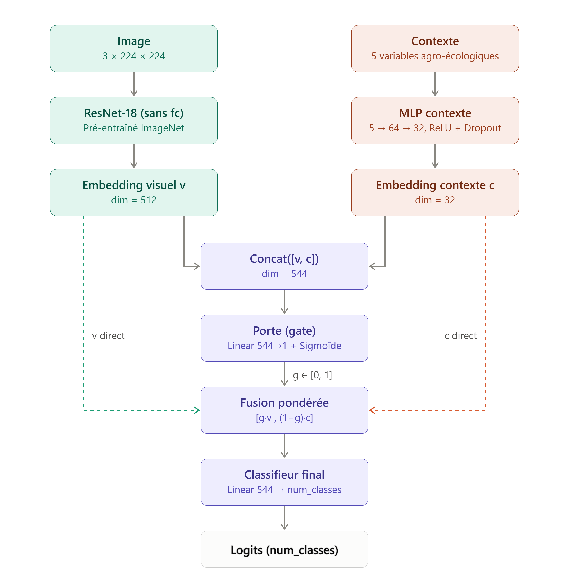
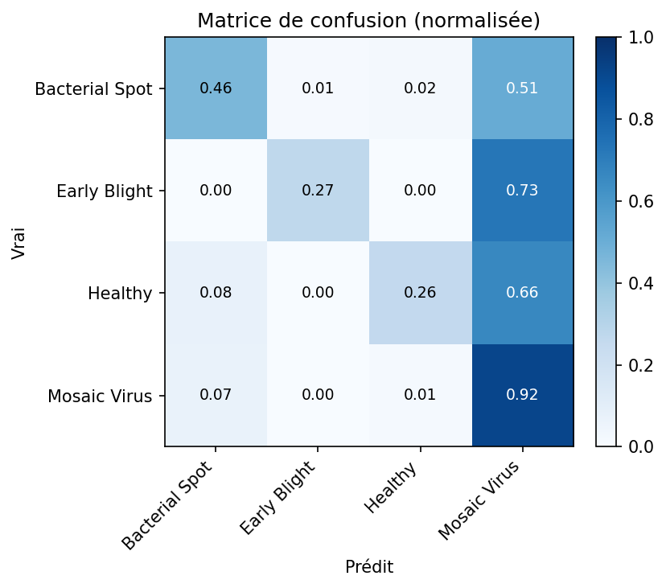

# ContextLeaf‑Réduit : Diagnostic multimodal de maladies des plantes

> **Implémentation allégée du framework ContextLeafXAI**
> *Inspiré de l'article : “Context aware multimodal plant disease diagnosis using agro ecological metadata and explainable inference”* (Nagur Zakeeya & Swarna Latha Sugali)

Ce dépôt propose une version simplifiée et reproductible de **ContextLeafXAI**, un cadre multimodal qui combine des **images de feuilles** et des **métadonnées agro‑écologiques** (température, humidité, pluviométrie, pH du sol, carbone organique) pour diagnostiquer les maladies des plantes.
Le modèle implémenté est une **Gated Fusion Model** : un ResNet‑18 pour l’image, un MLP pour le contexte, et une porte (gate) qui apprend à pondérer dynamiquement chaque modalité.

---

## 🏗️ Architecture du modèle

L’article original propose **LeafContextReasonNet**, une architecture à fusion guidée par la fiabilité des données. Notre implémentation en est une version réduite mais fonctionnelle.

| Composant | Rôle | Détail dans ce dépôt |
|-----------|------|----------------------|
| **Encodeur visuel** | Extraire les symptômes à partir de l’image | ResNet‑18 pré‑entraîné sur ImageNet, sans la couche `fc` → vecteur de 512 dimensions |
| **Encodeur contextuel** | Encoder les 5 variables agro‑écologiques | MLP : 5 → 64 → 32 (ReLU + Dropout) |
| **Mécanisme de porte (gate)** | Décider du poids relatif image/contexte | Petite couche linéaire (544 → 1) + Sigmoïde → \( g \in [0,1] \) |
| **Fusion** | Combiner les deux modalités | Concaténation pondérée : \( [g \cdot v,\; (1-g) \cdot c] \) |
| **Classifieur** | Prédire la maladie | Couche linéaire (544 → `num_classes`) |

**Différences avec l’article original** :

- L’article utilise EfficientNet‑B3 + ViT‑B/16 pour l’image ; nous utilisons un ResNet‑18 plus léger.
- L’article gère des métadonnées plus riches (météo, sol, géographie, saison, qualité des données) ; nous nous limitons à 5 features synthétiques corrélées au label.
- L’article propose une double explication (Grad‑CAM + attribution contextuelle) ; notre version se concentre sur la classification.

---

## 📂 Datasets utilisés

| Dataset | Contenu | Utilisation dans ce projet |
|---------|---------|----------------------------|
| **PlantDoc‑OD** (Object Detection) | Images de feuilles annotées (format XML) – 8 classes de tomate | **Entraînement** : les images sont copiées dans `dataset/train/<classe>` après mapping via `CLASS_MAP` |
| **PlantDoc‑Dataset** (classification) | Images déjà organisées en dossiers par classe | **Entraînement** : ajoutées aux mêmes classes cibles |
| **AD** | 4 classes : Healthy, Bacterial Spot, Early Blight, Mosaic Virus | **Test** : évaluation finale sur un jeu de données différent (cross‑dataset) |

**Classes cibles (8)** : Healthy, Bacterial Spot, Early Blight, Late Blight, Leaf Mold, Mosaic Virus, Septoria Leaf Spot, Yellow Leaf Curl.

> ⚠️ **Important** : Les jeux de données ne sont **pas** versionnés dans ce dépôt (voir `.gitignore`). Vous devez les télécharger séparément et les placer dans `raw_data/` (ou adapter les chemins dans `prepare_data1.py`).

---

## 📁 Rôle de chaque fichier

| Fichier | Description |
|---------|-------------|
| `prepare_data1.py` | **Préparation des données** : parcourt les dossiers bruts (PlantDoc‑OD, PlantDoc‑Dataset, AD), applique le mapping des classes et copie les images dans `dataset/train/` et `dataset/test/`. |
| `prepare_data2.py` | **Pipeline multimodal** : construit un DataFrame (image, label, split), génère 5 features contextuelles synthétiques corrélées au label, normalise les features (stats du train uniquement), et fournit les `DataLoader` PyTorch. |
| `model.py` | **Définition du modèle** : `GatedFusionModel` (ResNet‑18 + MLP + gate) et fonction `build_model()`. |
| `train.py` | **Boucle d’entraînement** : split stratifié train/validation, early stopping sur le macro‑F1, class weights pour le déséquilibre, sauvegarde du meilleur checkpoint et évaluation finale sur le test. |
| `evaluate.py` | **Métriques** : calcul des poids de classes, évaluation (`evaluate`) avec support d’un sous‑ensemble de classes (`restrict_labels`), rapport de classification, matrice de confusion. |
| `contextLeaf_reduit.ipynb` | **Notebook d’exécution** : enchaîne les étapes (préparation, entraînement, évaluation) de façon interactive. |

---
## 📊 Résultats

Les résultats ci-dessous correspondent à une exécution sauvegardée dans `checkpoints/`.
Le modèle a été entraîné sur les 8 classes de PlantDoc (avec un `noise_level` de [valeur de noise dans args.json]) et évalué en cross-dataset sur les 4 classes du jeu AD.

### 1. Configuration de l'expérience
*   **Époques maximum** : [20]
*   **Learning Rate** : [1e-4]
*   **Bruit contextuel (noise_level)** : [2.0]
*   **Meilleure époque (Early Stopping)** : [15]

### 2. Performances globales

| Métrique | Validation (PlantDoc) | Test (AD) |
| :--- | :--- | :--- |
| **Accuracy** | [0.596] | [0.679] |
| **Balanced Accuracy** | [0.596] | [0.477] |
| **Macro-F1** | [0.598] | [0.524] |
| **Weighted-F1** | [0.594] | [0.643] |

### 3. Rapport de classification détaillé (Test AD)
*Extrait de `classification_report.txt`*

| Classes | Precision | Recall | F1-score | Support |
| :--- | ---: | ---: | ---: | ---: |
| Bacterial Spot | 0.6111 | 0.4583 | 0.5238 | 96 |
| Early Blight | 0.7500 | 0.2727 | 0.4000 | 11 |
| Healthy | 0.8182 | 0.2596 | 0.3942 | 104 |
| Mosaic Virus | 0.6794 | 0.9175 | 0.7807 | 291 |
| **Accuracy** | | | 0.6793 | 502 |
| **Macro avg** | 0.7147 | 0.4771 | 0.5247 | 502 |
| **Weighted avg** | 0.6966 | 0.6793 | 0.6432 | 502 |

### 4. Matrice de confusion (Test AD)

*Cette matrice illustre les performances du modèle sur les 4 classes du jeu de test AD. Les lignes représentent les vraies classes, les colonnes les prédictions.*

## 📝 Réferences

**Zakeeya, N., & Sugali, S. L. (2026).**  
*Context aware multimodal plant disease diagnosis using agro ecological metadata and explainable inference.*  
**Discover Computing**, 29(734).  
DOI : [10.1007/s10791-026-10536-9](https://doi.org/10.1007/s10791-026-10536-9)
